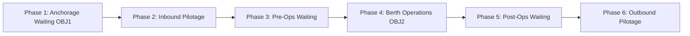

> **Conference Paper**: Presented at the *International Conference on Artificial Intelligence, Computer, Data Sciences and Applications (ACDSA 2027)* in Rio de Janeiro, Brazil.
{: .prompt-info }

Port call planning in sub-Saharan African maritime hubs relies heavily on subjective shipowner declarations. At the Autonomous Port of Cotonou (PAC), 68.8% of 2025 port calls suffered from structural underestimation of dwell time, with a median bias of 13.6 hours. To resolve this information asymmetry, we developed a data-driven machine learning system using 2,163 consolidated port calls (2023-2025) to predict anchorage waiting time and berth operations duration.

## Port Call Workflow & Problem Formulation

Vessel Turnaround Time (VTT) at the port decomposes into six chronological phases. Our study focuses on modeling the two most volatile components: anchorage waiting time ($\text{OBJ1}$) and berth handling duration ($\text{OBJ2}$).



To account for heavy-tailed distributions where extreme delays distort continuous regression, targets were framed as binary classification tasks using training set median thresholds: $\tau_{\text{rade}} = 6.0\text{ h}$ and $\tau_{\text{ops}} = 21.0\text{ h}$.

$$\text{class}(y) = \begin{cases} \text{FAST}, & \text{if } y \le \tau \\  \text{LONG}, & \text{if } y > \tau \end{cases}$$

> **Key Finding**: Spatialized congestion variables (terminal linear load, anchorage saturation) exerted a far stronger influence on delays than physical vessel characteristics such as gross tonnage or length.
> {: .prompt-tip }

## Benchmark & Operational Results

Evaluating five classifiers under a strict temporal validation protocol (training on 2023-2024, testing on 2025) identified **Random Forest** as the dominant architecture across both prediction objectives.

| Model | Macro-F1 | Accuracy | Expected Cost Reduction |
| --- | --- | --- | --- |
| **Shipowner Declaration (Baseline)** | 0.604 | 62.4% | Baseline |
| **Logistic Regression** | 0.530 | 62.3% | -0.1% |
| **XGBoost** | 0.622 | 67.3% | -12.4% |
| **LightGBM** | 0.649 | 69.1% | -18.2% |
| **CatBoost** | 0.633 | 68.1% | -15.0% |
| **Random Forest + Optuna (Final)** | **0.707** | **73.2%** | **-35.2%** |

By incorporating an asymmetric penalty ($C_{fn}/C_{fp} = 50$) tuned per fleet segment using Optuna TPE, the final model achieved 89% precision on critical long-call alerts while reducing total expected operational costs by 35.2% compared to shipowner declarations.

$$\mathbb{E}[\text{Cost}] = C_{fn} \times FN + C_{fp} \times FP$$

> **Deployment Constraint**: While the model achieves high accuracy on container ships (Macro-F1 = 0.729) and tankers (Macro-F1 = 0.696), performance drops on ro-ro and conventional vessels due to high operational variance. Deployment is strictly recommended for container and tanker terminals.
> {: .prompt-warning }

## Unsupervised Profiling & Machine Learning Implementation

Unsupervised K-Means clustering ($k^* = 3$, Silhouette = 0.115) isolated a bottleneck cluster ($C2$) composed entirely of conventional vessels. Although accounting for only 3.8% of calls, $C2$ represented 6,018 hours of berth immobilization, with a median berth stay of 72.5 hours (equivalent to four standard container ships).

```python
# filepath: src/models/optimize_rf.py
import optuna
from sklearn.ensemble import RandomForestClassifier
from sklearn.metrics import f1_score

def objective(trial, X_train, y_train, X_val, y_val, class_weight_mult):
    params = {
        'n_estimators': trial.suggest_int('n_estimators', 100, 500),
        'max_depth': trial.suggest_int('max_depth', 6, 20),
        'min_samples_split': trial.suggest_int('min_samples_split', 2, 10),
        'class_weight': {0: 1.0, 1: class_weight_mult}
    }
    
    clf = RandomForestClassifier(**params, random_state=42)
    clf.fit(X_train, y_train)
    preds = clf.predict(X_val)
    
    return f1_score(y_val, preds, average='macro')

```

This integrated framework demonstrates the operational value of replacing declarative practices with objective algorithmic estimations in port logistics infrastructure across West Africa.

```

```
